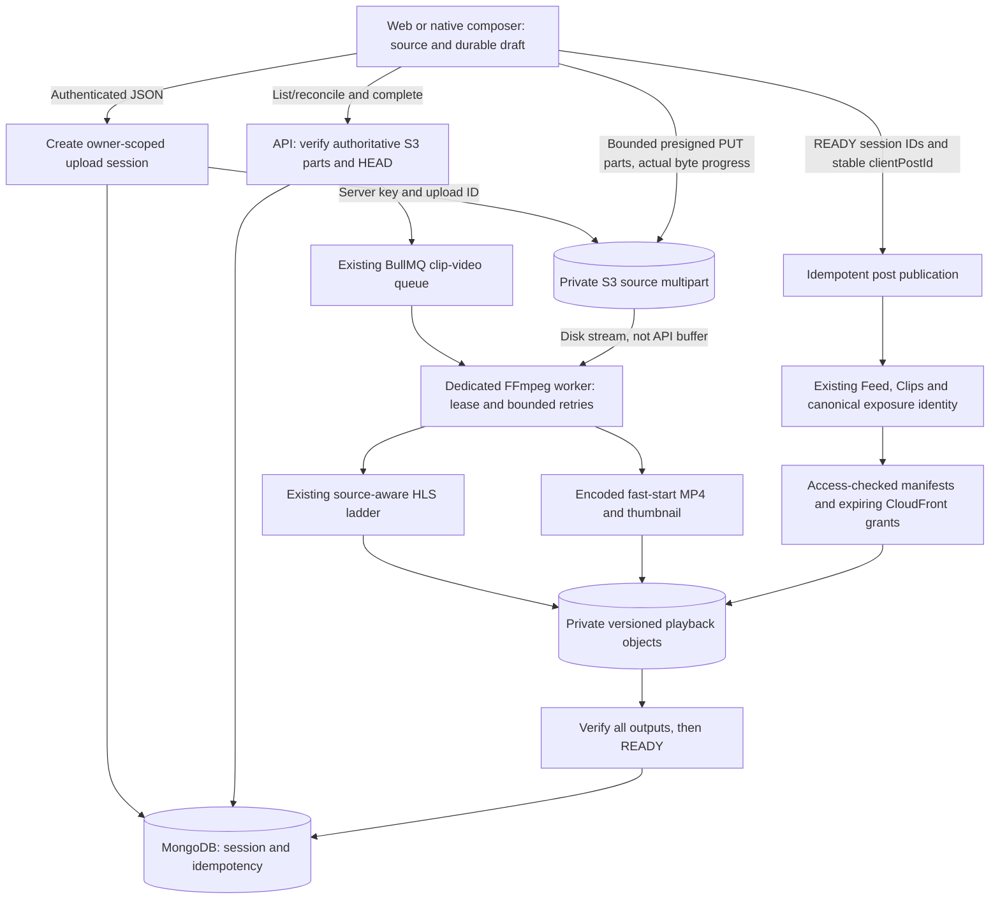

# SquadHunt 500 MiB post-video implementation report

Date: 19 October 2026. Verdict: **NOT READY** for activation.

**21 October iOS/Safari follow-up:** the full native workspace now builds, and
actual iOS Simulator transfers at exactly 500 MiB, recovery, HEVC/edited inputs,
publication and playback have passed against isolated AWS staging. Safari's
local-rendering and native-HLS blockers were fixed. See the current
[iOS/Safari report](POST_VIDEO_500MIB_IOS_SAFARI_FINAL_REPORT.md) and its sanitized
evidence for final browser/privacy/cleanup status and remaining activation gates.
This does not authorize production changes or claim physical iPhone execution.

Historical initial-implementation snapshot. The approved 20 October follow-up
replaces the one-hour NEW-pipeline asset lifetime described below with
five-minute renewable grants. See `POST_VIDEO_500MIB_RENEWAL_RECOVERY_PLAN.md`,
the follow-up validation report and the current `POST_VIDEO_500MIB_ROLLOUT.md`.
Earlier test limitations below are retained as historical evidence, not current
claims of what round-2 staging did or did not verify. Production activation is
still not authorized.

Repository implementation and local verification are complete to the extent
described below. This is not a claim that all acceptance criteria have passed.
No production infrastructure was changed, no production post was submitted, and
the new-upload feature remains disabled by default. Staging/cloud and complete
cross-platform upload/playback verification remain mandatory.

## A. Implementation summary

- Added an owner-authorized durable video upload session and a direct S3
  multipart path. Large source bytes bypass Multer and the API process.
- Enforced exactly 524,288,000 bytes per post video, five media slots and a
  1,073,741,824-byte aggregate video budget. Other upload surfaces are unchanged.
- Integrated byte progress, pause/cancel/retry, durable drafts, reconciliation
  and processing stages into Web and native post composers.
- Extended the existing HLS generator rather than building a second pipeline.
  Added a genuinely encoded H.264/AAC fast-start MP4 and generated thumbnail.
- Chose Option B: create a post only after every referenced video is READY.
  Stable client keys, publication reservations and canonical Post IDs prevent
  duplicate publication on response-loss retries.
- Added independently deployable worker configuration, scoped storage policy
  templates, private delivery, bounded cleanup, migrations and a rollback guide.
- Changed Feed source selection to prefer ready HLS, retaining optimized MP4
  fallback. Existing Clips windows, exposure identity and recommendation logic
  were not redesigned.

## B. Implemented architecture



The old <=50 MiB route remains available for older clients. New sessions require
the feature flag, dedicated-worker mode and private-delivery configuration.
Disabling the flag stops new sessions but does not strand existing authorized
status, part-signing, completion, cancellation and retry operations.

## C. Backend

`VideoUploadSession` persists ownership, declared size/type, server-controlled
S3 key/upload ID, expiry, attempts, leases, safe errors, verified output metadata,
publication association and cleanup markers. Temporary signed URLs and storage
credentials are not persisted in session DTOs.

Lifecycle:

`CREATED → UPLOADING → QUEUED → PROCESSING → READY`

The schema also supports UPLOADED recovery and FAILED/CANCELLED/EXPIRED terminal
or retry states. Completion verifies assembled S3 size, content type and the
server-created session metadata. Codec/container, packet/decode integrity,
duration, dimensions and orientation are verified asynchronously by the worker.

Authenticated endpoints under `/api/posts`:

| Method | Route | Purpose |
| --- | --- | --- |
| GET | `/video-uploads/policy` | Feature availability and exact resource limits |
| POST | `/video-uploads` | Idempotent owner-scoped session and multipart creation |
| GET | `/video-uploads/:id` | Safe session status |
| GET | `/video-uploads/:id/parts` | Authoritative resume reconciliation |
| POST | `/video-uploads/:id/parts` | Sign 1–4 valid parts, 15-minute expiry |
| POST | `/video-uploads/:id/complete` | Verify parts/object, queue processing |
| POST | `/video-uploads/:id/retry` | Bounded processing retry |
| DELETE | `/video-uploads/:id` | Cancel and abort unpublished upload |

Post creation retains its existing multipart form for images/covers. Videos use
`videoUploadIds`, `mediaOrder` and `clientPostId`. A server reservation checks
READY status, ownership, total size, output prefix and single-post association.
Failed publication compensates reservations; an existing canonical post wins a
lost-response retry. Unpublished sessions do not enter recommendation queries.

Read-only polling has its own per-owner rate budget, separate from write/signing
operations. Active owner sessions are bounded to five and 1 GiB, with a separate
new-session hourly limit. Additive indexes must be applied before activation;
the migration does not delete records or reset exposure history.

## D. Web

The shared upload engine uses Blob slices and XHR PUT, at most two 8 MiB parts in
flight. It does not read a complete 500 MiB file into a JS buffer. Progress uses
actual transfer events plus confirmed prior parts. Processing is a named stage,
not a simulated percentage.

Account/composer-scoped draft/session metadata persists in localStorage;
user-selected small covers persist in IndexedDB. Reloads require source
reselection when browser file access is lost. Mixed-media order must match the
restored draft. File name/size/lastModified identify reselection; this is not a
cryptographic content digest. Logout and account changes abort the previous
scope. Active uploads add a navigation warning. Closed tabs are not claimed to
continue transferring.

Updated page, post modal and achievement modal share this implementation.
Edited media still uses existing editor/export behavior. Achievement previews
use object URLs rather than eager full-file base64 copies.

## E. Android

The native `copyUploadPart` method copies at most one bounded part to a temporary
file using 64 KiB reads. Expo FileSystem streams that part via native binary PUT.
One part at a time is used on native; no full-video JS buffer is allocated.
Account-bound session metadata and durable source/draft files enable resume.
Completed S3 parts are reconciled before sending missing bytes. Free disk space
is checked before draft copies and part preparation.

Existing Media3 editing/export is retained. Unedited compatible source containers
may bypass needless export when the new server policy is enabled. PREPARING is
separate from UPLOADING. The UI has progress percentage and transferred/total MiB,
processing stages, Pause, Save and leave, and cancellation of saved uploads.

This implementation intentionally uses safe pause/resume on AppState background
or lock. It is **not** an Android foreground-service-backed continuous uploader.
After OS process termination, source/draft/session recovery is required. Resume
is initiated from the saved draft; uninterrupted background transfer is not
promised. Native OS network/low-storage/kill cases still need staging execution.

Samsung SM-S928B verification:

- Side-by-side debug QA app installed; existing production app/data preserved.
- Authorized zoro sign-in and Home confirmed on the phone.
- Composer and system video picker opened.
- Controlled local 495,092-byte, two-second H.264/AAC fixture selected.
- Video editor, first-frame preview and cover controls rendered correctly.
- Save draft, leave and reopen worked. The saved source and cover persisted
  through a force-stop/cold start; the video was restored to the composer.
- The flag remained off. No upload/publish request was submitted. The test draft
  and phone Download fixture were subsequently discarded; production media and
  existing app data were not removed.
- An unrelated development `POP_TO_TOP` warning and custom development-link
  profile landing were observed; navigating to the app root reached Home.

Screenshots are in workspace `artifacts/video-upload/`, particularly
`android-video-selected.png` and `android-cold-draft-restored.png`.

This is composer/draft device evidence, **not** proof of native 500 MiB upload,
network interruption recovery or playback of a newly published video.

## F. iOS

The same engine/session/draft policy applies. Swift FileHandle part copying is
bounded; existing AVFoundation editing/export is retained. Foreground native PUT
and safe pause/resume are implemented, not a background URLSession daemon.

TypeScript checks pass. A simulator build was actually attempted with Xcode:
`xcodebuild -workspace ios/SquadHunt.xcworkspace -scheme SquadHunt -configuration Debug -sdk iphonesimulator -destination 'generic/platform=iOS Simulator' CODE_SIGNING_ALLOWED=NO build`.

It failed with exit 70: no eligible destination; Xcode reports iOS 26.5 is not
installed. `simctl list devices available` returned no devices. No physical iOS
device or simulator execution passed. The Swift change is not reported as
compile-verified.

## G. Processing

Reused `generateClipHls`, existing BullMQ queue and source-aware ladder:

| Output | Target video bitrate | Video/audio | Notes |
| --- | --- | --- | --- |
| 360p short side | 0.7 Mbps | H.264 / AAC | Existing ladder; source-aware cap |
| 540p short side | 1.4 Mbps | H.264 / AAC | Eligible sources only |
| 720p short side | 2.8 Mbps | H.264 / AAC | Eligible sources only |
| 1080p short side | 5.0 Mbps | H.264 / AAC | Eligible sources only |
| Progressive fallback | 0.3–2.4 Mbps | H.264 main, yuv420p / AAC 96 kbps | <=720 short, <=1280 long side, fast-start |

HLS remains approximately two-second fMP4 with aligned keyframes. No needless
upscaling; low-bitrate sources avoid redundant high variants. Audio is omitted
for silent sources. Portrait, square and rotation are retained. The fallback is
encoded rather than stream-copied; its byte count is recorded. Actual size
depends on source complexity and duration and is not always smaller than an
already efficient low-bitrate original.

Resource limits are checked from probed metadata before packet/decode work:
default maximum duration 3,600 seconds (configurable downward), maximum dimension
8,192 and maximum pixel count 33,554,432. FFmpeg threads are bounded. Processing
is sequential per job and one job per initial worker. Abort and lease loss stop
encoding; in-flight probes/storage transfers are not guaranteed to stop instantly
and require operational timeout/restart testing.

All required variants, fallback and thumbnail are verified before READY.
Versioned objects are uploaded before variant playlists and master playlist.
Partial versions are tracked for cleanup. Job and database leases protect
duplicate deliveries and stale-worker recovery.

## H. Playback and recommendation safety

Web Feed attaches native HLS or the already installed Hls.js to the existing
video element; fatal errors switch to optimized MP4. Native PostCard uses the
existing Clip source policy and optimized fallback. HLS cache/prewarm selection
is aligned to avoid simultaneously warming a different progressive file.

Existing visibility autoplay, audio ownership, posters, bounded windows and
canonical IDs remain in their current owners. No new exposure is recorded by
upload, encoding or preload. Existing no-repeat, cross-surface exclusion,
1-second qualified video exposure, pagination and 45-day priority tests pass.

Chrome local Home playback and composer open/close were inspected before device
testing. Full new-output browser playback, Safari/WebKit, mobile browser network
interruption and private HLS startup must still be executed in staging.

## I. Infrastructure and observability

Prepared, not deployed:

- Dedicated ECS/Fargate worker: candidate 2 vCPU, 4 GiB RAM, 40 GiB ephemeral disk,
  one job and two FFmpeg threads. This is unbenchmarked production capacity.
- Existing API-compatible image and runtime secrets loader; no new framework.
- Redis/worker health endpoint, stalled-job logs, queue-count metrics, failed-job
  and queue-depth alarm templates.
- Additive IAM private source/output permissions; existing secret/DB/Redis and
  legacy Clip permissions must also be retained.
- S3 CORS merge template and source multipart-abort-after-two-days rule.
- Signed CloudFront playback behavior and explicit CloudFront source deny.

Templates contain placeholders and must be merged with existing configuration;
they are not blindly applicable complete bucket/distribution policies. YAML and
JSON syntax parsed locally; no AWS template validation/provisioning passed.

Capacity/cost inputs are still needed: uploads/day, source durations/bitrates,
original retention, view minutes, selected HLS variants, cache hit ratio,
encoding wall time/CPU/RSS/disk, queue age, region and current AWS unit prices.
At 500 MiB with 8 MiB parts there are 63 part PUTs plus initiate/list/complete/
verification operations. Retained originals, all derivatives and watched CDN
bytes—not just the upload limit—drive cost. No invented dollar estimate is used.

## J. Tests and builds actually executed

| Check | Result |
| --- | --- |
| Backend `npm run typecheck`, `npm run build` | Pass |
| New policy/service/publication suite | 17 tests pass; isolated real MongoDB for six publication/cleanup/lease tests |
| S3 multipart SDK suite | 3 pass: metadata/encryption, bound signing, pagination/completion |
| `npm run test:clip-hls` | 25 pass plus storage/CDN contracts |
| `npm run test:media-integrity` | 12 pass plus 7 S3 integrity tests and resource contract |
| `npm run test:private-media` | 7 pass plus REST/Socket contracts |
| `npm run test:discovery` | 568 checks; 23 integration tests; 230 unique Clips/24 pages; follow-state and 3 migration tests pass |
| Web TypeScript and Vite production build | Pass |
| Web selected upload/Feed/Clips tests | 73 pass |
| Web composer/cover/achievement/layering tests | 24 pass |
| Mobile TypeScript | Pass |
| Mobile upload/playback/prefetch tests | 18 pass |
| Mobile post-editor tests | 31 pass |
| Mobile Home Feed contract suite | 13 pass |
| Android native debug build/install | Pass; physical composer/draft smoke checks above |
| iOS simulator build | Blocked, exit 70, missing eligible platform/destination |
| IAM/worker YAML and template JSON parsing | Pass after correcting IAM scalar quoting |

Warnings remain in Web test output: existing jsdom canvas limitations, React
act/mock-prop warnings and experimental localStorage. Vite warns about large
chunks and stale Browserslist data. These did not fail the selected suites and
are not represented as silent/clean whole-repository test runs.

## K. Actual local file-size matrix

`node --import tsx scripts/validate-post-video-local.mts` transferred actual bytes
using the production Web upload engine, isolated MongoDB, a disk-backed loopback
S3 emulator, production session/worker service and real FFmpeg. No AWS client is
used. A deliberately lost PUT acknowledgement forced reconciliation; two already
accepted parts were reused at every size.

Fixtures are valid two-second 640x360 H.264/AAC MP4 files padded with a valid
`free` atom to each exact transfer size. This tests byte boundaries and resume,
**not** representative long-video compression, AWS throughput or device memory.

| Platform | Source bytes (MiB) | Parts | Upload/resume | Processing | MP4 output bytes | Playback |
| --- | --- | --- | --- | --- | --- | --- |
| Local Web engine | 10,485,760 (10) | 2 | Pass / 2 accepted parts reused | READY, 617 ms | 545,228 | ffprobe/derivative validation; no UI playback |
| Local Web engine | 52,428,800 (50) | 7 | Pass / 2 reused | READY, 622 ms | 545,163 | Same limitation |
| Local Web engine | 104,857,600 (100) | 13 | Pass / 2 reused | READY, 630 ms | 544,433 | Same limitation |
| Local Web engine | 209,715,200 (200) | 25 | Pass / 2 reused | READY, 740 ms | 544,433 | Same limitation |
| Local Web engine | 314,572,800 (300) | 38 | Pass / 2 reused | READY, 773 ms | 544,433 | Same limitation |
| Local Web engine | 524,288,000 (500) | 63 | Pass / 2 reused | READY, 933 ms | 544,433 | Same limitation |
| Android / iOS / real browsers via AWS | Required full matrix | — | Not executed | Not executed | — | Not executed |

Overall local elapsed times were 705, 805, 919, 1266, 1454 and 2261 ms respectively;
these include transfer, reconciliation and processing. They are not network
benchmarks. Required fallback, HLS and thumbnail byte counts were nonzero. Local
temporary source/part/output files and isolated records were cleaned by the
harness. Separate real-FFmpeg tests covered MOV/HEVC, portrait+audio, silent
landscape/360p, square, 1080p, 4K, rotation, corrupt input and cancellation.
Variable-frame-rate and representative long/high-motion/edited near-limit
workloads remain unexecuted.

## L. Performance

No comparable before/after device TTFF, rebuffer count, variant selection,
CloudFront hit ratio, playback byte total or memory trace was captured for newly
processed uploads. No improvement or regression is claimed. Passing bounded
preload/player/exposure tests is useful regression evidence, not a substitute
for these measurements. Earlier loading-delay fixes were not reopened.

## M. Storage and cleanup

New sources and outputs use separate private server-controlled prefixes.
Expired/cancelled unpublished sessions abort multipart and clean sources and
tracked versions. Attached session cleanup is bounded/fair and idempotent.
Deleted posts have a 24-hour grace; hard-deleted records receive a tombstone
grace. Another live reference prevents deletion. Permanent account deletion marks
its sessions; mere suspension does not destroy content. Deleted content's
sources and outputs are collected after grace. Failed cleanup is retried.

READY originals of live posts are retained by default. A positive
`POST_VIDEO_SOURCE_RETENTION_DAYS` needs an approved retention decision; 0 means
retain. No blanket playback expiry or irreversible live cleanup was applied.
Legacy media orphans outside new-session ownership are not swept by this change.
Failed encoding versions are deleted on error; tracked remnants are also
eligible when their session/content is collected. Cleanup throughput and source
retention need operational validation before activation.

## N. Privacy/security

Ownership, expiry, MIME allowlist, exact part count/size, bounded signing, verified
S3 completion, canonical key prefixes, resource limits and publication checks are
server-enforced. Source DTOs never return source URLs/keys or upload IDs. Signing
keys stay backend-only. Sources are not normal playback media.

Playback manifests use expiring HMAC prefix/viewer grants and recheck current
post, owner/viewer activity and established access policy. Child manifests remain
inside the same authorized prefix. Segments, MP4 and thumbnails use CloudFront
signed URLs. A flag fails closed unless signing configuration exists.

Local privacy tests verified public access, private-profile rejection for
anonymous viewers, owner access and deletion revocation at the manifest route.
Actual unsigned CloudFront/S3 denial, blocked/follower device cases and CORS/range
behavior on this new private prefix are **not verified**. Previously issued
asset grants can remain valid for up to an hour after privacy/deletion changes;
this is bounded, not immediate revocation. Strict instant revocation would require
a separately validated shorter/renewable or edge-authorization strategy.

## O. Deployment status and activation order

Nothing was deployed or enabled. See `POST_VIDEO_500MIB_ROLLOUT.md` and
`infra/post-video.env.example` for detailed prerequisites.

1. Review additive migration against target MongoDB/DocumentDB and apply/verify
   indexes with feature disabled. No live migration was run here.
2. Deploy compatible API and dedicated worker; disable API embedded FFmpeg.
3. Merge IAM, S3 CORS/lifecycle, private origin and trusted-key-group behavior.
4. Verify unsigned source/playback denial and authorized HLS/MP4/range/CORS.
5. Deploy clients with native part-copy support; keep new-session flag off.
6. Execute controlled staging matrix including interruptions, worker restart,
   account privacy/deletion, Feed/Clips playback and performance comparison.
7. Approve retention/resource budgets and controlled activation only afterward.

Rollback stops new sessions first and keeps compatible workers/status/completion
running until in-flight work drains. Do not delete derivatives, session records
or exposure history, and do not re-enable an old embedded worker that cannot
understand `process-upload` jobs.

## P. Remaining blockers and files

Required before activation: real AWS near-500 MiB source transfer and playback;
native/browser full recovery matrix; iOS build/runtime; Safari/mobile browsers;
private delivery/CORS/range/CDN cache verification; representative worker CPU/RSS/
disk/latency/cost benchmark; DocumentDB/index deployment checks; retention
approval; end-to-end controlled post publication with zero duplicates; and
security/operational review. Queue retry behavior was tested at service/database
lease level, not by killing a live Redis/ECS worker. Signed URL renewal during
very long playback also needs device verification.

Changed/added backend files (paths relative to `modular-backend`):

```text
package.json
src/config/env.ts
src/server.ts
src/clip-worker.ts
src/video-worker-launcher.ts
src/infrastructure/jobs/queue.ts
src/infrastructure/storage/s3.ts
src/infrastructure/storage/s3.multipart.test.ts
src/modules/posts/posts.routes.ts
src/legacy-src/routes/posts.js
src/legacy-src/models/Post.js
src/legacy-src/models/VideoUploadSession.js
src/legacy-src/controllers/postController.js
src/legacy-src/controllers/userController.js
src/legacy-src/controllers/authController.js
src/legacy-src/controllers/videoUploadController.js
src/legacy-src/services/videoUploadService.js
src/legacy-src/services/videoUploadService.test.js
src/legacy-src/services/videoPostPublicationService.js
src/legacy-src/services/videoPostPublication.integration.test.js
src/legacy-src/utils/postVideoPolicy.js
src/legacy-src/utils/postVideoPolicy.test.js
src/legacy-src/utils/postVideoDelivery.js
src/legacy-src/utils/dto.js
src/legacy-src/utils/privateMediaDelivery.js
src/legacy-src/utils/jobQueue.js
src/legacy-src/utils/videoProcessing.js
src/legacy-src/utils/videoProcessing.integrity.test.js
src/legacy-src/utils/clipHlsProcessing.js
src/legacy-src/utils/clipHlsProcessing.test.js
src/legacy-src/utils/clipHlsProcessing.integration.test.js
scripts/migrate-video-upload-indexes.js
scripts/validate-post-video-local.mts
infra/post-video-worker.yaml
infra/post-video-iam.yaml
infra/post-video-s3-cors.json
infra/post-video-s3-lifecycle.json
infra/post-video-cloudfront-behavior.json
infra/post-video-source-deny-statement.json
infra/post-video.env.example
docs/POST_VIDEO_500MIB_ROLLOUT.md
docs/POST_VIDEO_500MIB_IMPLEMENTATION_REPORT.md
```

Web (`frontend`):

```text
src/pages/CreatePost.tsx
src/components/CreatePostModal.tsx
src/components/CreateAchievementModal.tsx
src/components/MediaSwiper.tsx
src/features/post-upload/videoUploads.ts
src/features/post-upload/videoUploads.test.ts
src/features/post-upload/usePostVideoUploads.ts
src/features/post-upload/usePostVideoUploads.test.tsx
src/features/post-upload/PostVideoUploadStatus.tsx
src/features/post-upload/postCoverStore.ts
src/features/post-upload/postCoverStore.test.ts
src/features/post-upload/FeedAdaptiveVideo.tsx
src/features/post-upload/FeedAdaptiveVideo.test.tsx
```

Native contribution (`mobile-ui/arc-mobile`; these overlap an extensively dirty
pre-existing worktree, so the entire Git diff is **not** attributed to this task):

```text
app/create-post.tsx
src/features/post-editor/videoUploadPolicy.ts
src/features/post-editor/videoUploadEngine.ts
src/features/post-editor/videoUpload.ts
src/features/post-editor/videoUpload.test.mts
src/features/post-editor/postDrafts.ts
src/features/post-editor/media-export.ts
src/features/post-editor/PostCreation.contract.test.mjs
src/utils/localMedia.ts
src/components/PostCard.tsx
src/services/feedMediaPrefetch.ts
src/services/feedMediaPrefetchPolicy.ts
modules/arc-media-editor/android/src/main/java/expo/modules/arcmediaeditor/ArcMediaEditorModule.kt
modules/arc-media-editor/ios/ArcMediaEditorModule.swift
package.json
```

The Samsung check uses the existing Gradle QA application-ID suffix facility.
No unrelated mobile work was reverted or committed. No packages were installed.

## Q. Final verdict

**NOT READY.** Significant implementation and local regression evidence exist,
including exact-500-MiB loopback transfer/reconciliation and validated processing.
This does not satisfy the requested real-platform/cloud acceptance matrix.
Keep the feature disabled until the listed deployment, privacy and staging
validation gates have actually passed.
